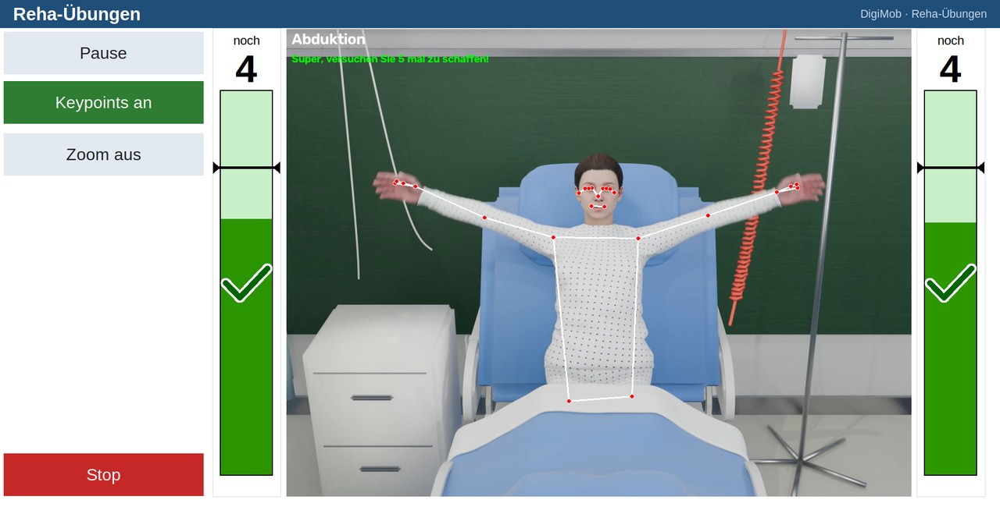
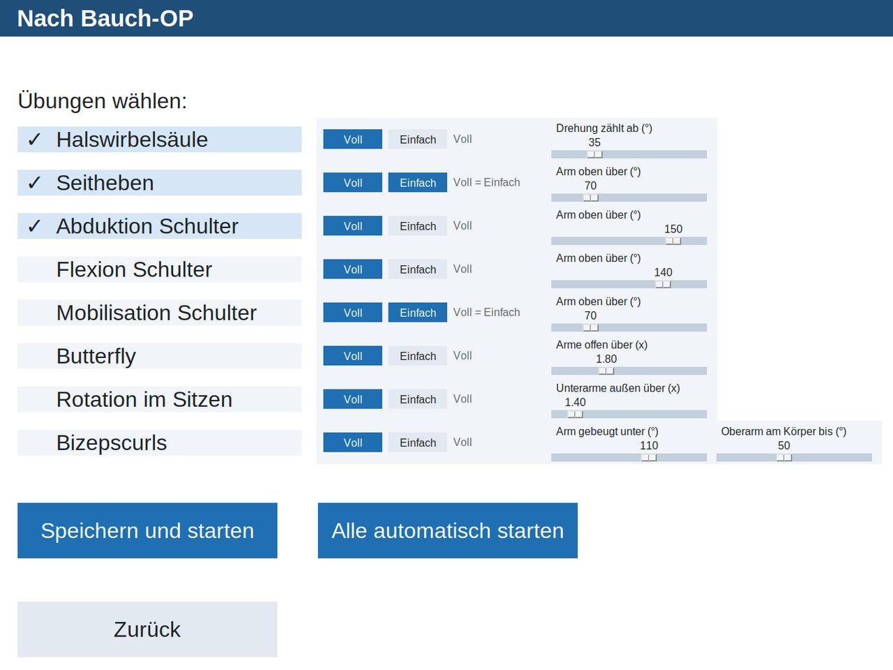

[English](README.md) | **Deutsch**

# 🏥 DigiMob – Kamerabasierter Reha-Trainer 🤸

Ein intelligenter Reha-Assistent, gebaut mit **Python**, **MediaPipe** und **OpenCV**. Er beobachtet Patientinnen
und Patienten über eine Webcam, zählt jede Wiederholung anhand der Gelenkwinkel und begleitet das Training mit
gesprochenem Feedback und Live-Fortschrittsbalken – damit nach einer Bauch- oder Brust-OP sicher trainiert werden
kann, ohne dass jemals persönliche Daten gespeichert werden.

| 🎥 Übung mit erkannten Körperpunkten | ⚙️ Übungsauswahl mit einstellbaren Schwellen |
|---|---|
|  |  |

*Die Screenshots verwenden das 3D-Demovideo als Kamerabild, daher ist keine echte Person zu sehen.*

---

## ✨ Funktionen

### 🏋️ Geführte Übungen
* **8 Reha-Übungen**: Abduktion Schulter, Seitheben, Flexion Schulter, Mobilisation Schulter, Bizepscurls,
  Butterfly, Rotation im Sitzen und Halswirbelsäule.
* **🎬 3D-Demovideos**: Vor jeder Übung zeigt ein gerendertes 3D-Video genau, wie die Bewegung ausgeführt wird.
* **📋 Trainingspläne**: OP-Art und postoperativen Tag wählen – die App legt die Anzahl der Wiederholungen
  automatisch fest.

---

### 🧠 Intelligente Zählung
* **Gelenkwinkel-Erfassung**: Misst Gelenkwinkel und Abstände für jede Körperseite getrennt.
* **Robuste Erkennung**: Hysterese, Haltezeiten, Medianfilter und Sichtbarkeitsprüfung halten die Zählung stabil,
  auch wenn die Posenerkennung zittert.

---

### 📊 Live-Feedback
* **Fortschrittsbalken**: Ein Balken pro Arm mit Countdown, Ziellinie und grünem Haken für jede Wiederholung.
* **🔊 Sprachbegleitung**: Gesprochene Meldungen kündigen das Ziel, die Hälfte, die letzte Wiederholung und das
  Ende an.

---

### 🎚️ Anpassbar & datensparsam
* **Voll & Einfach**: Niedrigere Ziele für schwächere Patienten, pro Übung per Schieberegler einstellbar und
  ausfallsicher gespeichert.
* **🔒 Datenschutz zuerst**: Keine Benutzerprofile, kein gespeicherter Fortschritt, keine Patientendaten.

---

## 📖 Hintergrund

DigiMob ist ein Projekt von **Prof. Hanno Homann** an der Hochschule Hannover. **Tanja Wysinsky**, Pflegekraft an
der Medizinischen Hochschule Hannover, hat die App in ihrer Bachelorarbeit (Sommersemester 2025) eingesetzt und die
Übungen medizinisch beraten. Sie nutzt die App bis heute weiter.

Ich habe das Projekt im Herbst 2026 erweitert. Die Commit-Historie zeigt, wer was beigetragen hat.

---

## 🚀 Meine Beiträge

* **🧠 Neue Zählalgorithmen**: Die Zähllogik für alle acht Übungen neu entwickelt.
* **🩺 Live-Tests an der MHH**: Die Übungen gemeinsam mit Frau Wysinsky aufgenommen, auch mit nachgestellten
  Patientenbewegungen, und jeden Algorithmus an diesen Aufnahmen abgestimmt und geprüft.
* **🎬 3D-Anleitungsvideos**: Die alten Beispielfotos durch mit **Blender** gerenderte Videos ersetzt – eine
  3D-Figur halb sitzend im Krankenbett in einem nachgebauten Krankenzimmer, die Bewegungen in Python gescriptet und
  nach den echten Aufnahmen getaktet.
* **⚡ Schnellere Verarbeitung**: Posenerkennung in einen Hintergrund-Thread verlegt – **6,6 → 9,8 fps**
  (Abduktion) und **6,0 → 13,7 fps** (Halswirbelsäule).
* **🏗️ Saubere Architektur**: Eine gemeinsame Basisklasse für alle Übungen, der Übungsablauf von der Oberfläche
  getrennt und eine Kamera-Abstraktion für Live-Webcam oder aufgezeichnete Videos.
* **🧪 94 automatisierte Tests**: Unit-Tests und ein Systemtest, der 58 echte Aufnahmen abspielt und die
  **exakte** Wiederholungszahl verlangt.
* **🔒 Datensparsamkeit**: Benutzerdatenbank und gespeicherten Fortschritt entfernt.
* **🔊 Sprachausgabe**: Für Python 3.12 repariert und gesprochene Meldungen abbrechbar gemacht.

---

## ⚙️ Funktionsweise

```
Kamerabild ─► Zoom (optional) ─► MediaPipe-Pose ─► uebung.update(pose)
                                                          │
       Oberfläche: Video + Balken ◄── Sprachausgabe ◄─────┘
```

Jede Übung berechnet aus der Pose einen Messwert – zum Beispiel den Winkel Hüfte–Schulter–Ellbogen – und zählt eine
Wiederholung, wenn das Ziel erreicht wird und die Bewegung zurückkehrt. Die Übungen sind reines Python ohne
MediaPipe-Import, deshalb können die Tests aufgezeichnete Körperpunkte ohne Kamera abspielen.

---

## 🚀 Erste Schritte

### 📋 Voraussetzungen

Python 3.12, eine Webcam und eine Audioausgabe.

### 1. Abhängigkeiten installieren

```bash
python -m venv .venv && source .venv/bin/activate
pip install -r requirements.txt
```

### 2. Stimmmodell herunterladen

Das deutsche Stimmmodell ist zu groß für git. `de_DE-thorsten-low.onnx` von
[Piper voices](https://huggingface.co/rhasspy/piper-voices/tree/main/de/de_DE/thorsten/low) herunterladen und nach
`sportuebungen/stimmen/` legen.

### 3. App starten

```bash
cd sportuebungen
python Hauptprogramm.py
```

Mit `--entwickler` erscheint der Knopf **„Aufnahmen testen“**, der Aufnahmen statt der Webcam abspielt.

### 4. Tests ausführen

```bash
cd sportuebungen
pytest
```

Keine Kamera, kein Fenster und keine Audioausgabe nötig.

---

## 🕹️ Bedienung

1. **Hauptmenü** → *Übungen wählen*
2. **OP-Art** → Bauch-OP oder Brust-OP, dazu der postoperative Tag
3. **Auswahl** → Übungen ankreuzen und Schwellen anpassen, oder alle automatisch starten
4. **Übungsseite** → *Pause*, *Keypoints* (erkannte Körperpunkte zeigen), *Zoom* und *Stop*

---

## 📂 Projektstruktur

* `Hauptprogramm.py`: Die Tkinter-Oberfläche – Menüs, Übungsauswahl und Übungsseite.
* `uebungslauf.py`: Der Übungsablauf – Kamera, Posenerkennung, Zählung und Sprache für jedes Bild.
* `uebung.py`: Die gemeinsame Basisklasse aller Übungen.
* `uebungen.py`: Die einzige Liste aller Übungen und Trainingspläne.
* `abduktion.py`, `bizepscurls.py`, …: Eine Datei pro Übung mit Texten und Schwellen.
* `camera/`: Live-Webcam und Videowiedergabe mit derselben Schnittstelle.
* `pose.py`, `mediapipe_modelle.py`: Posendaten und der MediaPipe-Wrapper.
* `sprachausgabe.py`: Sprachausgabe mit Piper TTS.
* `schwellen.py`: Speichern und Laden der Schwellen.
* `tools/`: Werkzeuge für Aufnahmen und Keypoint-Extraktion.
* `einheitentest.py`, `systest.py`: Unit-Tests und Systemtest.
* `recordings/`: 58 aufgezeichnete Übungen als Körperpunkte mit ihrer Soll-Anzahl.
* `demos/`: Die gerenderten 3D-Anleitungsvideos.
