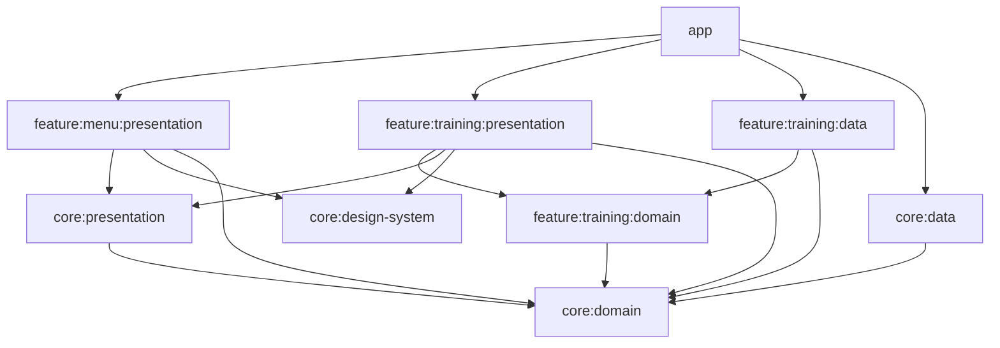

# DigiMob for Android

DigiMob is the Android port of the DigiMob desktop app (`../python/`) for the hospital tablet: guided
rehab exercises after an operation. The front camera watches the patient, MediaPipe detects the pose,
and the app counts the repetitions. It shows one progress bar per arm and announces milestones by voice.

Compared with the desktop app:
- Like the desktop, each exercise has **Voll | Einfach** plus one slider per threshold, and the app
  saves the setting.
- There is no Bedienungsanleitung and no Aufnahmen testen.
- Speech uses Android TextToSpeech (Google's male German voice) instead of Piper.
- The debug build can **record** exercises on the tablet with a ground truth (like
  `tools/record_exercise.py`), and the system test replays those recordings too.

Target device: Android 14 tablet (`minSdk` 34), landscape.

---

## Build, run, test

Run these from this folder. In Android Studio, open the folder with *File → Open*.

```sh
./gradlew assembleDebug        # build the APK
./gradlew installDebug         # install on the connected tablet (adb)

./gradlew testDebugUnitTest :core:domain:test :feature:training:domain:test   # unit tests
./gradlew :core:domain:systemTest                                             # the 58 PC recordings, see Testing
./gradlew :core:domain:tabletTest                                             # only the tablet recordings
./gradlew lintDebug
```

The build reads two things from the desktop app next to this folder, so `../python/` must exist:
- **Demo videos and pose model:** `../python/demos/*.mp4` and `../python/models/pose_landmarker_full.task`.
  The `copyDesktopAssets` task in `app/build.gradle.kts` copies them into the APK at build time, so git
  holds only one copy of each.
- **Recordings:** `../python/systest.txt` plus the keypoints and `summary.json` in
  `../python/recordings/`, used by the system test.

The debug build differs from the release build in one way: it logs every live camera frame's keypoints
(see [Debugging on the tablet](#debugging-on-the-tablet)).

---

## Architecture

The app uses **Clean Architecture with feature-layered modules**. The code is split by feature first
and by layer within each feature:

| Layer | Contains | May depend on |
|---|---|---|
| `domain` | pure Kotlin: models, rules, interfaces | `core:domain` only |
| `data` | implementations of the domain interfaces (camera, MediaPipe, DataStore, TTS) | its own `domain`, `core:domain` |
| `presentation` | ViewModels, Compose screens | its own `domain`, `core:domain`, `core:presentation`, `core:design-system` |

The rules that follow from this:
- **Features never depend on each other.** Code that two features need lives in a `core` module.
- **Only `:app` knows every module.** It wires them together with Koin and navigation.
- **The domain modules contain no Android code.** They are plain JVM modules (`digimob.jvm.library`),
  so all the counting logic is testable without a device.

### Modules

```
:app                              Application, MainActivity, NavHost, Koin setup, asset copy
:core:domain                      Result/DataError, the exercises and their counting logic (pure Kotlin)
:core:data                        DataStore for the thresholds (Voll/Einfach or slider values)
:core:presentation                UiText, ObserveAsEvents, dropUnlessResumed, German titles and messages
:core:design-system               theme, colours, buttons, page layout
:feature:menu:presentation        main menu → OP type + day → exercise selection with sliders
:feature:training:domain          TrainingSession, Milestones, HeadZoom, interfaces for camera and voice
:feature:training:data            CameraX (+ video), MediaPipe, TextToSpeech, clock, recording files
:feature:training:presentation    training screen, bars, demo player, recording screen (debug)
build-logic/convention            Gradle convention plugins (digimob.*)
```



The menu feature has no `domain` or `data` module of its own. Its only data is the thresholds of each
exercise, and the training feature needs them too, so it sits in `core:domain` (interface) and `core:data`
(implementation). The exercises are in `core:domain` for the same reason: the menu needs their titles
and presets, and training needs their counting.

### What happens with one camera frame

```
CameraX (front camera, 640×480, newest frame only)
  └─ CameraXPoseSource        rotate upright, unmirrored                     feature:training:data
       └─ PosePipeline        optional head zoom (crop around the nose)
            └─ MediaPipePoseDetector   PoseLandmarker "full", VIDEO mode, CPU → Pose (33 landmarks)
                 └─ Flow<Result<PoseFrame, SourceError>>
TrainingViewModel                                                     feature:training:presentation
  ├─ TrainingSession.tick()       intro timer, "Prima" timer          feature:training:domain
  ├─ TrainingSession.onFrame()    → Exercise.update(pose, t)          core:domain
  │                               → Milestones → Speaker.say()        (voice: AndroidSpeaker)
  ├─ BarFeedbacks                 confirm flash, short hold, peak line
  └─ TrainingState → TrainingScreen (mirrored image, keypoints, bars, message)
```

Every camera frame also drives the session's clock (`tick()`); there is no separate timer. The
interfaces in `feature:training:domain` are generic over the image type (`PoseSource<Image>`,
`TrainingViewModel<Image>`). The app uses `Bitmap`, and the tests use `String`, so the domain never sees
an Android class.

---

## The modules in detail

### `:core:domain`: the exercises (pure Kotlin)

This module is a 1:1 port of the desktop counting logic. Class names and exercise keys keep the Python
names, and the keys are also the folder names under `../python/recordings/`.

| File | Python original | What it does |
|---|---|---|
| `Result.kt`, `DataError.kt` | – | typed results instead of exceptions (`Result.Success` / `Result.Error`, `map`, `onSuccess`, `onFailure`) |
| `exercise/Pose.kt` | `pose.py` | `Landmark`, `Pose` (raw + normalised landmarks, `hip(side)`: the virtual hip from both shoulders), landmark numbers per side and the sets the keypoints view shows |
| `exercise/ExerciseMath.kt` | `calculate_angle_distance.py` | angle at a joint, distance, progress 0..1 (can go above 1, up to 1.25) |
| `exercise/Exercise.kt` | `uebung.py` | base class: `update(pose, t)` → counter, `progress()` → one `Bar` per side, `HoldTime` |
| `exercise/Armheben.kt` | `abduktion.py` … | Abduktion, Seitheben, Flexion, Mobilisation: virtual hip–shoulder–elbow angle per arm |
| `exercise/Bizepscurls.kt` | `bizepscurls.py` | elbow angle with hysteresis and 0.15 s hold time; upper arms must stay at the body |
| `exercise/Butterfly.kt` | `butterfly.py` | wrist distance relative to shoulder width |
| `exercise/Rotation.kt` | `rotation.py` | wrist distance relative to elbow distance; upper arms at the body |
| `exercise/Halswirbelsaeule.kt` | `halswirbelsaeule.py` | head rotation from face landmarks 0–6, each change of direction counts |
| `exercise/Threshold.kt` | `schwellen`/`bereich`/`einfach` attributes | one adjustable threshold: key, Voll and Einfach value, slider range, unit (1° or 0.05x steps), and `ThresholdError` |
| `exercise/ExerciseCatalog.kt` | `uebungen.py`, `Uebung.werte`/`preset_von`/`pruefe` | `ExerciseId`, `OpType` (Bauch-OP / Brust-OP and their exercises), `PostOpDay` (day → repetitions), `create(id, target, values)`, `thresholds(id)`, `values(id, preset)`, `presetsOf(id, values)`, `validate(id, values)` |
| `exercise/ThresholdRepository.kt` | `schwellen.py` | interface: observe and save the thresholds of each exercise |

How an exercise works:
- `update()` runs every frame and has three parts:
  - `measure()` computes angles or distances
  - `ready()` is an optional gate, e.g. "upper arms at the body"
  - `count()` is the state machine that counts a repetition
- An invalid frame (no person, coincident points, gate closed) never counts and empties the bars.
- Repetitions are counted per side, and `total` is the lower of the two. A repetition only counts once
  both arms have done it.
- `target = null` means "count only, never done". Only the system test uses it.

The thresholds, with their Voll and Einfach values and the slider range (Python's `bereich`):

| Exercise | Slider | Voll | Einfach | Range |
|---|---|---|---|---|
| Abduktion | Arm oben über | 150° | 120° | 40–175° |
| Seitheben, Mobilisation | Arm oben über | 70° | 70° (same) | 40–175° |
| Flexion | Arm oben über | 140° | 110° | 40–175° |
| Bizepscurls | Arm gebeugt unter / Oberarm am Körper bis | 110° / 50° | 120° / 60° | 30–155° / 20–90° |
| Butterfly | Arme offen über (× shoulder width) | 1.80x | 1.50x | 1.20–3.00x |
| Rotation | Unterarme außen über (× elbow distance) | 1.40x | 1.30x | 1.20–3.00x |
| Halswirbelsäule | Drehung zählt ab | 35° | 28° | 20–80° |

`validate()` is Python's `pruefe`: exactly the exercise's thresholds, each above 0 and inside its
range, and a `min_X` below its `max_X` (no exercise has such a pair today).

> **The counters exist twice: in Python and in Kotlin.** Any change to a threshold or to the counting
> logic must go into both `../python/` and this module. The system test keeps the two implementations
> in step.

### `:core:data`: saving the thresholds

- **`DataStoreThresholdRepository`** stores them in a Preferences DataStore, like `schwellen.json`:
  - a preset as its name: `"<exercise>" = "einfach"`
  - hand-set values as deviations from Voll: `"<exercise>.<threshold>" = value`
  - Voll stores nothing.
  - A broken file, an unknown preset or values that fail `validate()` fall back to Voll
    (`ReplaceFileCorruptionHandler`), and the problem is logged.
  - A failed write returns `DataError.Local.DISK_FULL` or `UNKNOWN`. The selection page shows it as a
    dialog.
  - The file is still called `presets`, so an "Einfach" saved by an older version is kept.
- **`coreDataModule`** (Koin) provides the DataStore and binds the repository to `ThresholdRepository`.

### `:core:presentation`: shared UI helpers

- `UiText`: a text that is either a string resource or a plain string. ViewModels hold texts this way
  and never a `Context`.
- `ObserveAsEvents`: collects a ViewModel's one-time events while the screen is visible.
- `dropUnlessResumed` (two-argument variant; androidx has the zero-argument one): ignores a second tap
  while a navigation transition is running. Without it, a double tap opens two training screens.
- `ExerciseUi.kt`: the German titles of exercises, presets, OP types and days, the slider labels
  (`thresholdLabelRes`) and value formatting ("150°", "1,80x"), and the mapping of `ExerciseMessage`
  and `DataError` to `UiText`.

### `:core:design-system`: look and feel

- `DigiMobTheme` uses the desktop colours (header `#1f4e79`, surface `#f1f4f8`, selection `#d6e6f7`)
  and has a dark scheme. `DigiMobTheme.colors` (`DigiMobColors`) adds the bar colours, which run from
  yellow to green, plus the target line, peak line, confirm flash and video overlay.
- Components, all built on Material 3:
  - `DigiMobButton(kind, size)`: `PRIMAER`, `SEKUNDAER`, `GEFAHR` (Stop/Beenden), `AN` (toggle on),
    `ANGEHALTEN` (paused); `ButtonSize.NORMAL` or `KOMPAKT` (one line, for the training header)
  - `PageScaffold`: the blue header bar with the title, on the right `actions` (default
    "DigiMob · Reha-Übungen")
  - `CenteredColumn`: centred content that scrolls on small screens
  - `DigiMobSegmentedToggle`: Voll | Einfach
  - `DigiMobSelectButton`: an exercise on the selection page
  - `DigiMobSlider`: a threshold slider with its label
  - `DigiMobStepper`: a number with − and + (the ground truth of a recording)
- `AppIcons` holds the project's icons.

### `:feature:menu:presentation`: the menus

The menu uses the MVI pattern: State, Action, ViewModel, and a `Root` and a `Screen` composable per page.

| Page | ViewModel | What it does |
|---|---|---|
| `MainMenuScreen` | – | *Übungen wählen*, *Aufnehmen* (debug build only), *Beenden* |
| `OpTypeScreen` | `OpTypeViewModel` | Bauch-OP / Brust-OP, and the post-op day that sets the number of repetitions. The day survives process death (`SavedStateHandle`). |
| `ExerciseSelectionScreen` | `ExerciseSelectionViewModel` | Tick exercises and set each one's thresholds: Voll/Einfach, a status ("Voll", "Einfach", "Voll = Einfach", "angepasst", "ungültig") and one slider per threshold. Dragging shows the value, letting go validates and saves it. *Speichern und starten* (ticked exercises) or *Alle automatisch starten*. |

`MenuNavigation.kt` holds the menu's navigation graph (`menuGraph`), with type-safe routes in
`MenuRoutes.kt`. The menu doesn't know the training feature. It reports
`onStartTraining(ids, target)`, and `:app` turns that into the training route.

### `:feature:training:domain`: the training run (pure Kotlin)

- **`TrainingSession`** (`uebungslauf.py`) takes the queue of fresh exercises through these phases:

  ```
  INTRO ──(demo played once and ≥ 10 s)──▶ COUNTING ──(target reached)──▶ DONE ──(5 s "Prima")──▶ next exercise / FINISHED
  ```

  - It counts only while `COUNTING`.
  - `skipIntro()` (double tap on the demo) ends the intro at once and silences the voice; outside the
    intro it does nothing.
  - Pause stops everything, and paused time doesn't count towards the intro or "Prima".
  - `stop()` silences the voice.
- **`Milestones`** (`sprachausgabe.milestones`) makes the announcements: start, half way, "noch N",
  last repetition, done. Each comes at most once per exercise.
- **`HeadZoom`** (`apply_zoom`): the crop around the nose, smoothed (EMA 0.2), always inside the image.
  The integer rounding is the same as in Python.
- **Interfaces:**
  - `LivePoseSource`: the camera, a `Flow<Result<PoseFrame, SourceError>>`
  - `Speaker`: `say(Announcement)` and `stop()`
  - `Clock`
- `SourceError` is `NO_CAMERA`, `CAMERA_FAILED` or `POSE_FAILED` (50 failed detections in a row).
- **`Recording.kt`**: for recording on the tablet, `GroundTruth` (Python's `parse_reps`: one number
  for both sides, or left/right with `reps` = the lower one), `RecordingSummary`, and the interfaces
  `RecordingCamera` (pose + video) and `RecordingRepository` (the take folders).

### `:feature:training:data`: camera, pose, voice

- **`CameraXPoseSource`** (the shared code is `cameraPoseFrames`):
  - It opens the front camera (or the back one if there is no front camera) with `ImageAnalysis`.
  - It uses 640×480 and keeps only the newest frame, like the desktop's `PoseThread`.
  - The camera is bound to its own lifecycle, which starts when the flow is collected and ends when
    collection is cancelled.
  - On close it clears the analyzer first, then closes the model on the analysis thread.
- **`PosePipeline`**: one image → optional zoom → pose. With zoom, a second detector finds the nose on
  the full image. It ends the flow after 50 failures in a row.
- **`MediaPipePoseDetector`**: `PoseLandmarker` in VIDEO mode with one person, confidence 0.5, the "full"
  model and the CPU, as on the desktop. Timestamps are forced to rise strictly.
- **`AndroidSpeaker`**:
  - It uses Google's TextToSpeech engine with the offline male German voice `de-de-x-deb-local`. Without that
    voice it takes Google's default German voice; without Google or its German, the device's default
    engine. The log (tag `Sprache`) names the voice in use.
  - It queues announcements (`QUEUE_ADD`).
  - Announcements made before the voice is loaded wait.
  - `stop()` also drops waiting announcements.
  - The texts are in `res/values/strings.xml`, with plurals for "Wiederholung(en)".
- **`CameraXRecordingCamera`**: the same camera and pose, without zoom, plus CameraX `VideoCapture`
  (SD, no sound). If the camera can't run analysis and video together, it records keypoints only.
  The recording screen switches it off like the training screen does when the app is hidden; a
  running take ends as with Stop (the video is finalised first) and waits for the ground truth.
- **`FileRecordingRepository`**: the take folders `<exercise>/rec<N>/` with `keypoints_full.jsonl`,
  `summary.json` (`RecordingSummaryDto`, the fields of `record_exercise.py`) and `video.mp4`. A folder
  without `summary.json` is an aborted take and is removed on the next recording.
- **`ElapsedRealtimeClock`**: a monotonic clock in seconds.
- **`trainingDataModule`** (Koin) binds all of these to their domain interfaces.

### `:feature:training:presentation`: the training screen

- **`TrainingViewModel`**:
  - It starts once the camera permission is granted. It loads the saved thresholds, builds fresh
    exercises with the day's target and creates the `TrainingSession`.
  - It then collects the camera flow and turns each frame into `TrainingState`.
  - When the app is no longer visible (Home, screen off; `TrainingRoot` sends `OnScreenHidden` on
    `ON_STOP`), the exercise pauses and the camera is switched off. Back on screen the camera runs
    again, but the exercise stays paused until the patient taps the button ("Angehalten" → Pause).
  - When the last exercise is done, it sends `TrainingEvent.Finished`, and the screen returns to the
    main menu.
- **`TrainingScreen`** shows the exercise and "Übung i von n" in the header, and the controls on its
  right: Pause, Keypoints, Zoom, Stop. Below is the exercise area, laid out the same for every
  exercise: fixed slots left and right of the video and one under it, the video the largest 4:3 that
  fits (800×600 dp on the tablet). Slots an exercise doesn't use stay empty, so the video never moves.
  - The camera image is 4:3 and **mirrored**, so the patient's left is on the left.
  - During the intro, the 3D demo (`DemoPlayer`, ExoPlayer, looped, mirrored) takes the image's place.
    `DemoSkipOverlay` lies on top: a double tap skips the intro, a small hint says so.
  - `KeypointOverlay` draws the skeleton when Keypoints is on: only the points the exercise computes
    from (`ExerciseCatalog.landmarks`).
- **Bars** (`bar/`): the layout depends on the exercise's `BarStyle`.
  - `SPLIT`: one vertical bar per arm, left and right of the video
  - `SINGLE`: `SpreadBar` under the video, for Butterfly and Rotation: grows from the middle to both
    sides like opening arms
  - `CENTER`: `CenterBar` under the video, grows from the middle to the left or the right, for
    Halswirbelsäule

  Each bar shows "noch N", the target line at 80 % of its length and an arrow meaning "go back now"
  (down on the vertical bars, towards the middle on `SpreadBar`).
  `BarFeedback` adds the green flash with a tick after a counted repetition, keeps the last value for
  0.4 s while the pose is briefly lost, and draws the peak line of the current repetition.
- **Recording** (`recording/`, debug build only): `RecordingViewModel` and `RecordingScreen`, see
  [Recording on the tablet](#recording-on-the-tablet).
- `CameraPermission` and `KeepScreenOn` are shared by both camera screens.
- **`TrainingNavigation.kt`**: `trainingGraph` with `TrainingRoute(exerciseIds, target)` and
  `RecordingRoute`.

### `:app`

- **`DigiMobApp`**: starts Koin with all modules.
- **`MainActivity`**: full screen, with system bars hidden again after the permission dialog, and the
  `NavHost` that joins `menuGraph` and `trainingGraph`.
- The manifest sets `sensorLandscape`.

### `build-logic/convention`

These Gradle plugins keep the build files short:

| Plugin | For |
|---|---|
| `digimob.android.application` / `digimob.android.library` | SDK versions, Java 17, JUnit 5 |
| `digimob.android.feature` | library + Compose + Koin + navigation + the core modules (presentation modules) |
| `digimob.android.compose` | Compose compiler + BOM + Material 3 |
| `digimob.jvm.library` | pure Kotlin modules (domain) |
| `digimob.koin`, `digimob.kotlinx.serialization` | Koin, KotlinX Serialization |

All versions are in `gradle/libs.versions.toml`.

---

## Testing

- **Unit tests** use JUnit 5, AssertK, Turbine and fakes instead of mocks. They cover:
  - every exercise
  - the maths, `HoldTime`, `Milestones`, `HeadZoom` and `TrainingSession` (with a fake clock)
  - `BarFeedback`
  - the ViewModels
  - the DataStore repository (on a temporary file)
- **The system tests** replay recorded keypoints through the Kotlin exercises and assert the counts,
  per side, exactly. Two tasks with the same test class, one list each; `./gradlew check` runs both:
  - `:core:domain:systemTest`: `../python/systest.txt`, the 58 PC-webcam recordings. It gives exactly
    the same results as Python's `systest.py` and prints the same lines, e.g.
    `abduktion/rec1: 3/3 voll (links 3, rechts 3)`.
  - `:core:domain:tabletTest`: only `systest_tablet.txt`, the recordings made on the tablet (Android
    MediaPipe, ~10 fps), named `tablet/abduktion/rec1`. Only Kotlin reads this list. Empty, it says
    so and passes.

---

## Recording on the tablet

The debug build has an **Aufnehmen** button in the main menu, the tablet version of Python's
`tools/record_exercise.py`:

1. Choose the exercise and Voll/Einfach (the thresholds the test counts with).
2. *Aufnahme starten*: start and end in the exercise's starting position, the test counts from the
   first frame. While recording, the screen shows what the app counts.
3. *Aufnahme beenden*, then enter how many repetitions were really done, counted yourself (left and
   right, or one number for Butterfly and Rotation). That is the ground truth.
4. *Speichern*, or *Verwerfen* to keep nothing.

Then, with the tablet on USB:

```sh
tools/pull_recordings.sh            # tablet → recordings/<exercise>/rec<N>/, adds them to systest_tablet.txt
./gradlew :core:domain:tabletTest   # only the tablet recordings: does the app count exactly the ground truth?
```

The script deletes the pulled takes on the tablet. Videos stay out of git (`*.mp4`); keypoints and
`summary.json` are committed like the Python recordings. If a take fails the test, watch its
`video.mp4` to check the ground truth. If the exercise was done wrong, comment the line out in
`systest_tablet.txt` with the reason; otherwise the counting or the thresholds need fixing, in
Kotlin *and* Python.

---

## Debugging on the tablet

- **The camera must see the head, both shoulders and the arms.** The hips may be outside the picture:
  no exercise uses them; the arm angles are measured against a virtual hip computed from the
  shoulders. Turn on *Keypoints* and check that the exercise's points have dots.
- **Debug build only:** every camera frame's keypoints are written to logcat under the tag `Keypoints`,
  in the recordings' JSONL format. Capture them with:

  ```sh
  adb logcat -v raw -s Keypoints:I > take.jsonl
  ```

  You can then replay the lines through the Python counters.
- **Release build:** `./gradlew assembleRelease` builds an unsigned APK, because there is no release key
  yet. For a test, sign it with the debug key and run `adb install -r` over the debug build.
